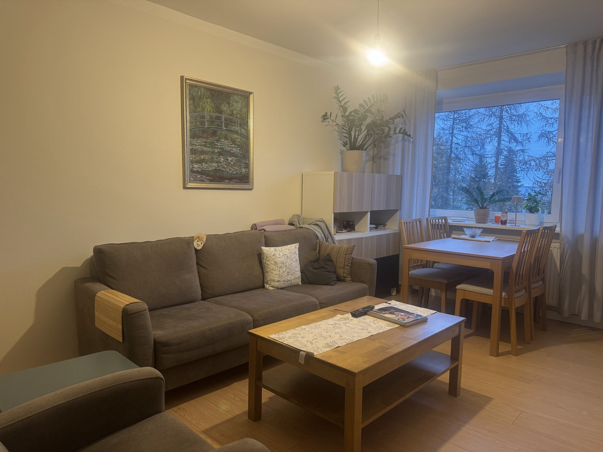
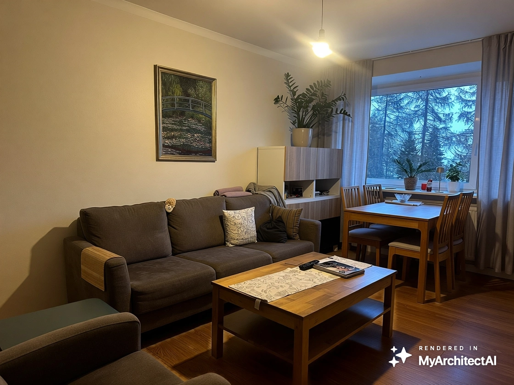
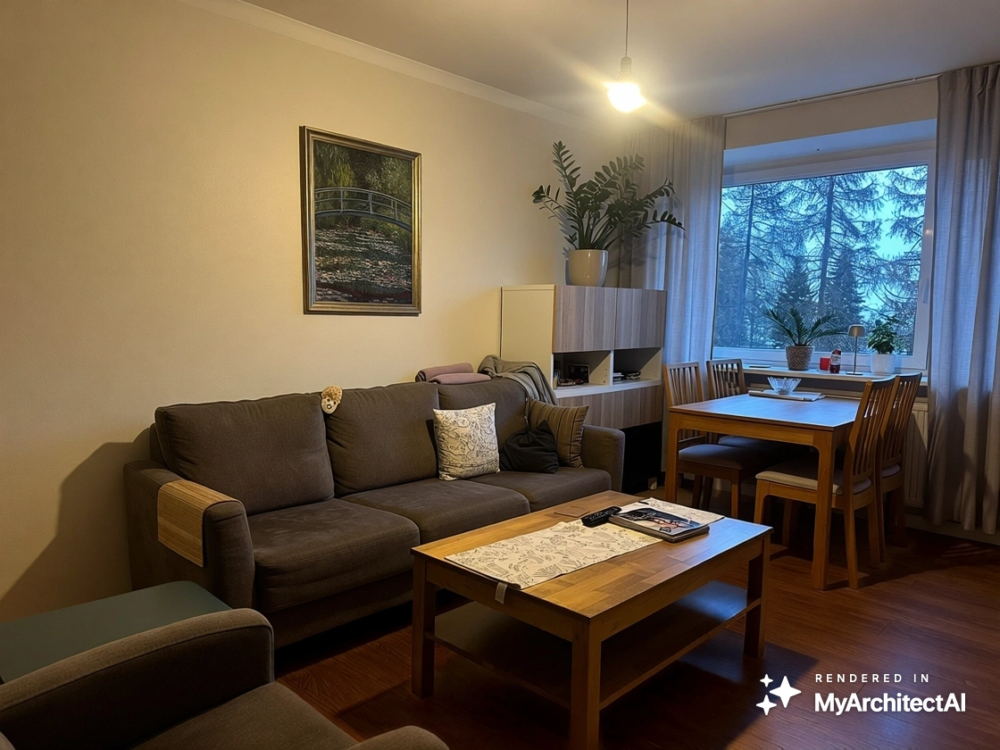
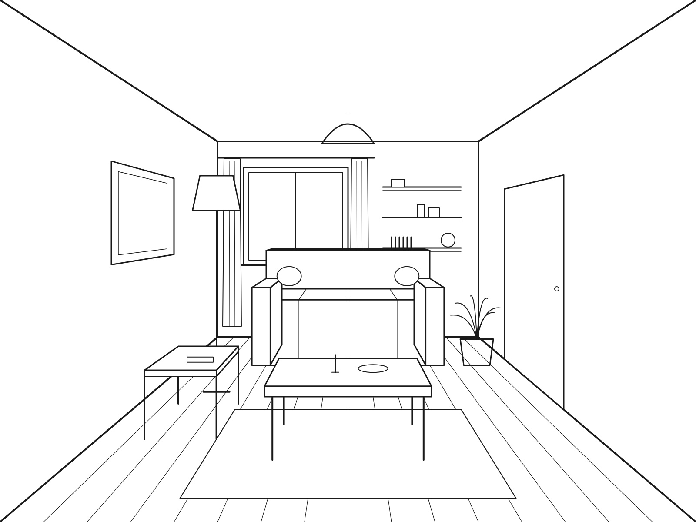
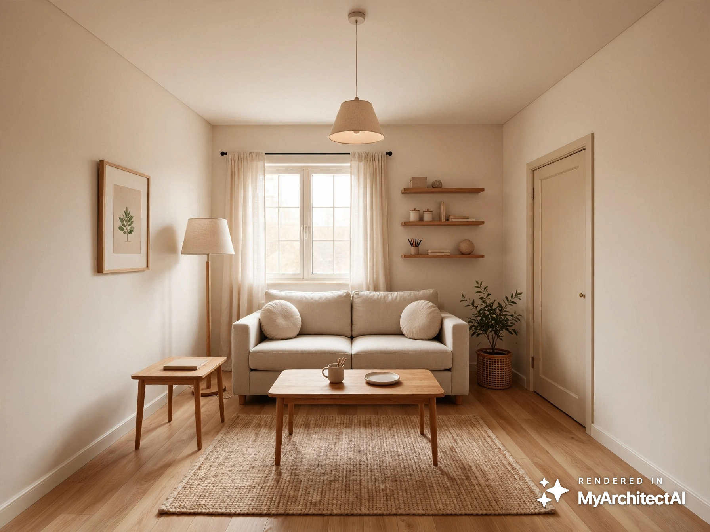
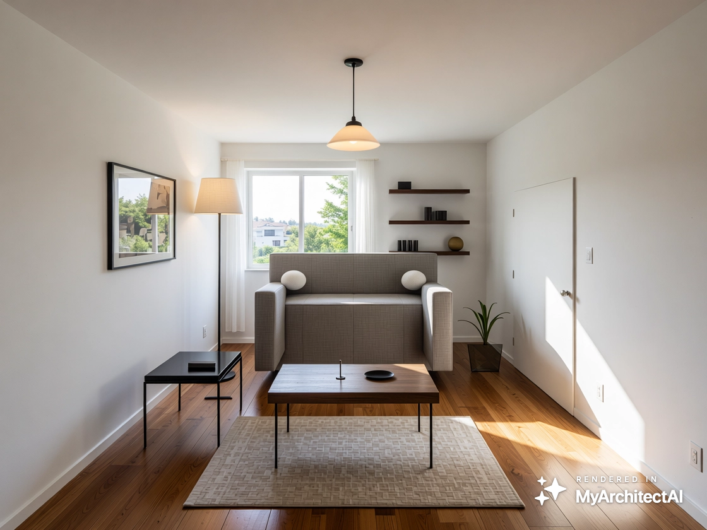
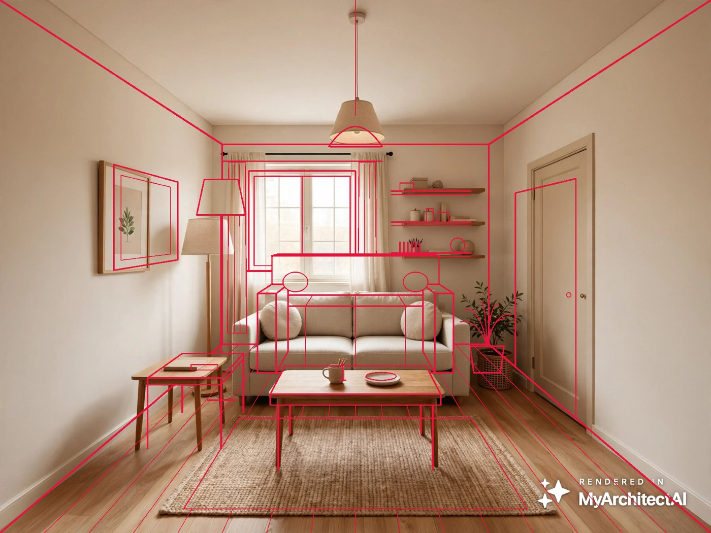
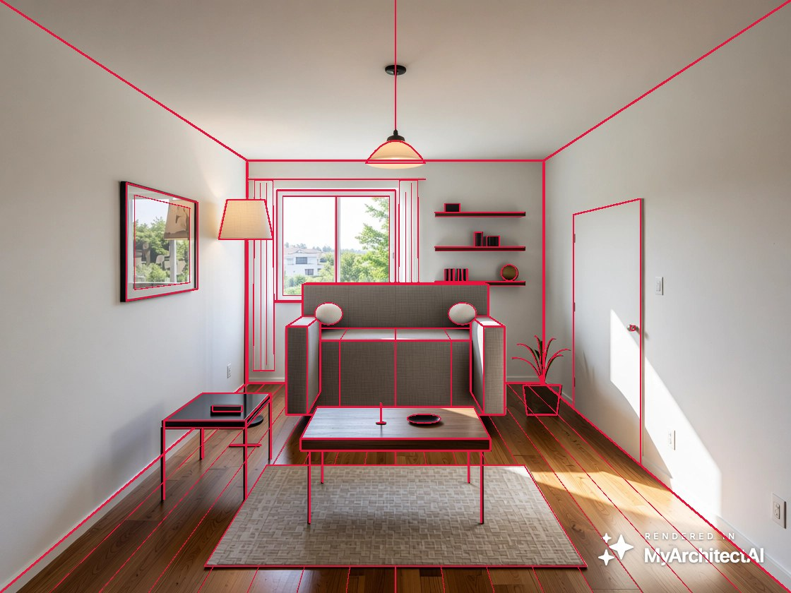
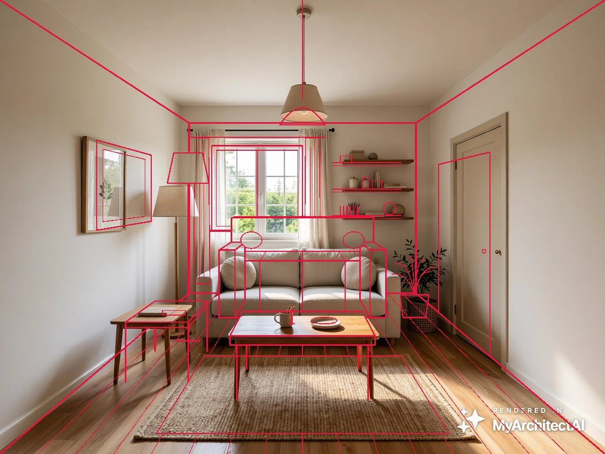

# Learning log

What I tried, what broke, what I learned.

---

## Day 1 — 9 Nov 2026

**Goal:** I wanted to see what happens when I give the AI my own living room and a simple drawing.

**Tool:** MyArchitectAI (free trial, 6 of 10 renders used)

**Inputs:**
- A: a photo of my living room (iPhone photo, evening light)
- B: a simple line sketch of a living room (made with AI to simulate an architect's drawing)

### Test 1: changing the floor in my living-room photo

| Try | Prompt | Mask | Result |
| --- | --- | --- | --- |
| 1 | "Replace the light wooden floor with a dark walnut wooden floor…" (verb first) | Part of the floor | Uneven colour, old floor still visible near the window and under the dining table, planks changed direction |
| 2 | "Dark walnut wooden floor, wide planks, matte finish" (describes the result, from the in-app tip) | Whole floor, including under the furniture and over the chair legs | Even colour, the chair and table legs survived, the rest of the room unchanged. Colour came out slightly different than expected, not exactly walnut (maybe wrong lighting) |

| Original photo | Try 1 (fail) | Try 2 |
| --- | --- | --- |
|  |  |  |

**What I learned:** unny thing: the help page said start with a verb, but the app itself said don’t. The app seemed to be right

**Honest problem:** I changed two things at once (prompt style AND mask), I'm assuming changing both was necessary.

### Test 2: does the style library change the geometry?

| My sketch | With style | No style |
| --- | --- | --- |
|  |  |  |

Red = my original sketch lines laid over the render:

| With style | No style | Style + daylight edit |
| --- | --- | --- |
|  |  |  |

I used Claude to run the measurement (to see the accuracy) and here’s how it works. It shows how many of my sketch lines still have a matching edge in each render (same image size, 3 tolerance levels):

| Render | Strict | Medium | Loose |
| --- | --- | --- | --- |
| No style | 71% | 74% | 79% |
| Style + daylight edit | 52% | 62% | 75% |
| With style | 40% | 53% | 68% |

**What I saw:**
- With style: looks beautiful and realistic, but the door, floor lamp, side table and picture moved or grew, and the lamp shade changed shape.
- No style: almost everything stays where I drew it, but the sofa looks like a stiff box. It copies my drawing too literally.

**The trade-off:** accurate vs pretty.

**My mistake:** my first comparison used images of different sizes, which isn't fair. I re-ran it at the same size and the ranking stayed the same.

**Open question:** the daylight edit (made from the styled render) moved things *closer* to my sketch. I don't know why yet.

**Next:** set up ComfyUI and try ControlNet. Can it keep the geometry AND make the furniture look real?
