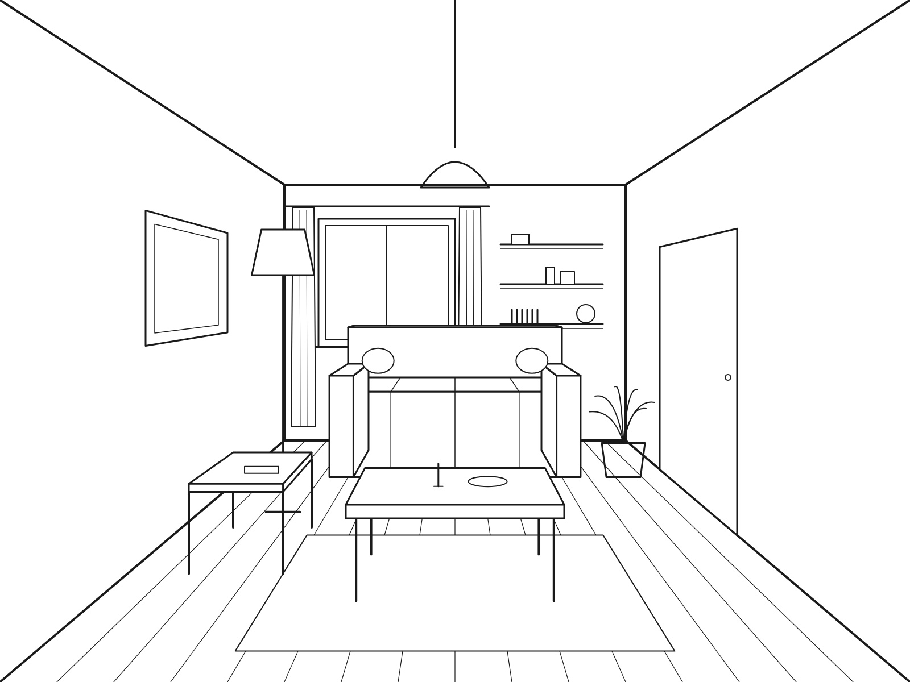
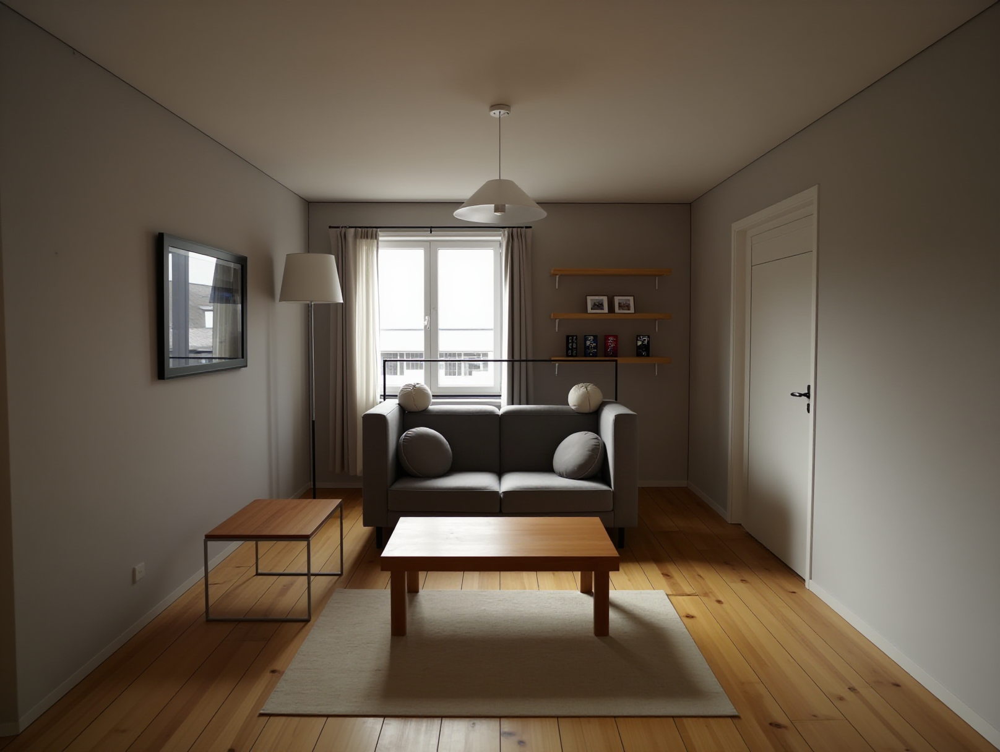

# Interior render experiments

<!-- Draft written with Claude. Karoliina: make it sound like you, then delete this line. -->

I'm testing how well AI renderers keep the geometry of a room
(walls, windows, doors, furniture) while making it photorealistic,
and measuring it instead of just looking.

I'm new to this field. I started studying AI seriously in November 2026, and this repo is my learning log. It started with MyArchitectAI: I tested it, got curious how a tool like that might work behind the scenes, and started rebuilding a similar process myself in ComfyUI.

**How I work:** I study with Claude. I ask it to explain the concepts, to make me guess the result before every test, and to explain why things happened. I run the tests, write down my guesses and judge the realism myself. Claude helps with the code and the geometry measurement. Each experiment says exactly who did what.

| My sketch | My best render so far (Experiment 3) |
| --- | --- |
|  |  |

## What I found so far

1. **A style makes it prettier but moves things.** In MyArchitectAI, without a style about 74% of my sketch lines stayed in place; with a style, about 53%. (Experiment 1)
2. **The prompt decides *what*, the seed decides *where*.** With a short prompt, a new seed gives a completely different room. Words alone can't hold a layout. (Experiment 2)
3. **Two guides together work better than one.** Canny follows every line but looks fake, depth looks real but loses flat things like windows. Depth 0.60 + canny 0.30 kept about 67% of my sketch on average over 3 seeds, with the best realism so far. (Experiment 3)
4. **One number is never enough.** A render can score 95% and still look terrible. I always check the score, my own eye, and more than one seed. (Experiment 3)
5. **AI 3D models improved a lot in four months.** I rebuilt my parents' apartment in 3D with three model generations. You can walk through two of them in your browser. (Experiment 4)

## Experiments

- [Experiment 0 — Bootcamp work: a character from my own face, a realistic tech influencer, a product ad](experiment-00.md) (Nov)
- [Experiment 1 — MyArchitectAI: floor edits and how a style moves the geometry](experiment-01.md) (9 Nov)
- [Experiment 2 — ComfyUI basics: seeds, prompts and describing a sketch in words](experiment-02.md) (10 Nov)
- [Experiment 3 — ControlNet: my sketch as input, canny vs. depth vs. both, finding the right strength](experiment-03.md) (11 Nov)
- [Experiment 4 — One apartment, three AI models: my parents' home in 3D from July to November](experiment-04.md) (Nov) · try [Round 1](https://claude.ai/artifact/G5kgYgDm56qwGTLdSSsH7w) and [Round 2](https://claude.ai/artifact/DgagVXnPVq53nVFKwBR2Qf) in 3D

## How I measure geometry

I put my sketch lines on top of the render and count how many of them still have an edge nearby (within about 8 pixels, less than 1% of the image width). More lines kept = the AI moved less of my room.

- It only makes sense when the render is made *from* my sketch, so the camera stays the same.
- It's not perfect: a render that just paints my lines on top scores high, and wooden floor planks can match by accident. That's why I always look with my own eyes too.
- Changing only the seed moves the score by about 6 points, so smaller differences can be just random.

The script is [measure_geometry.py](measure_geometry.py). Claude wrote it with me, and I ran it myself in Google Colab to check that it gives the same numbers as in my logs.

## Next

- Test MLSD, a guide that only follows straight lines and is made for architecture.
- Use a better input: a screenshot from a 3D model, like architects would give a renderer.
