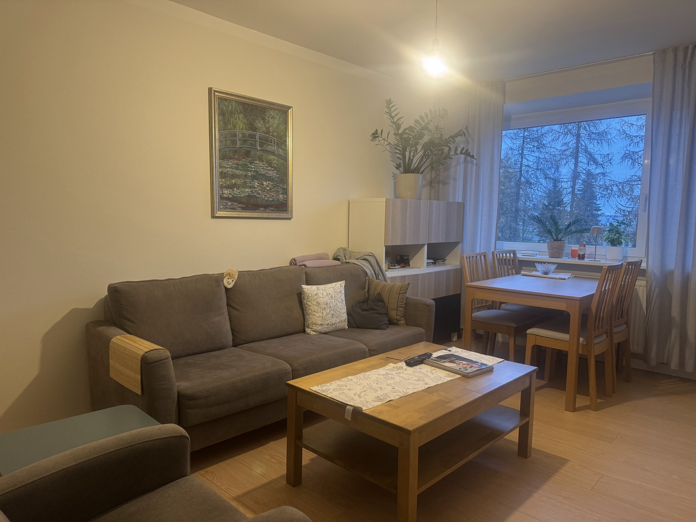
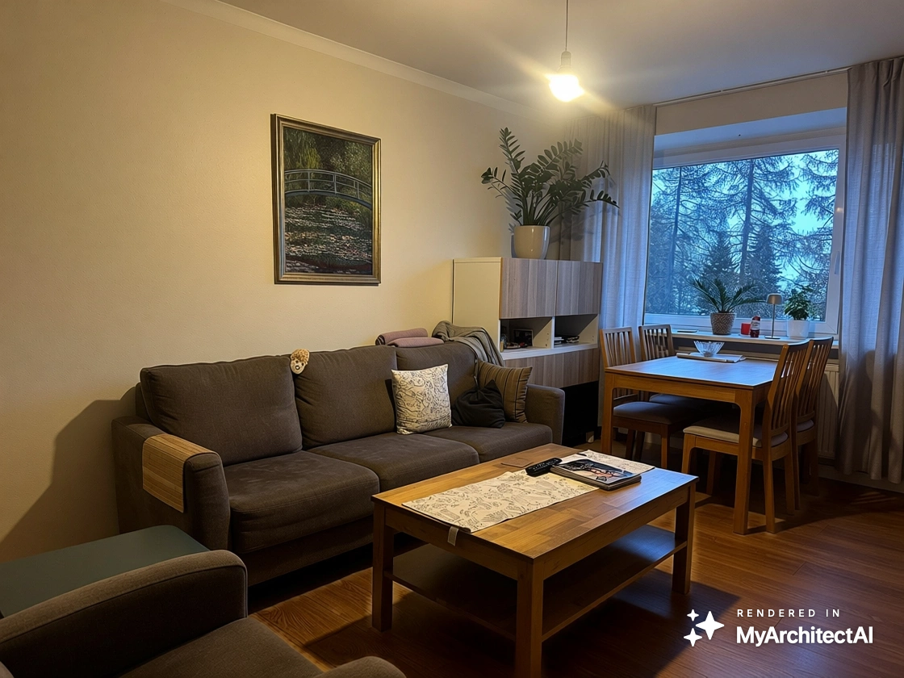
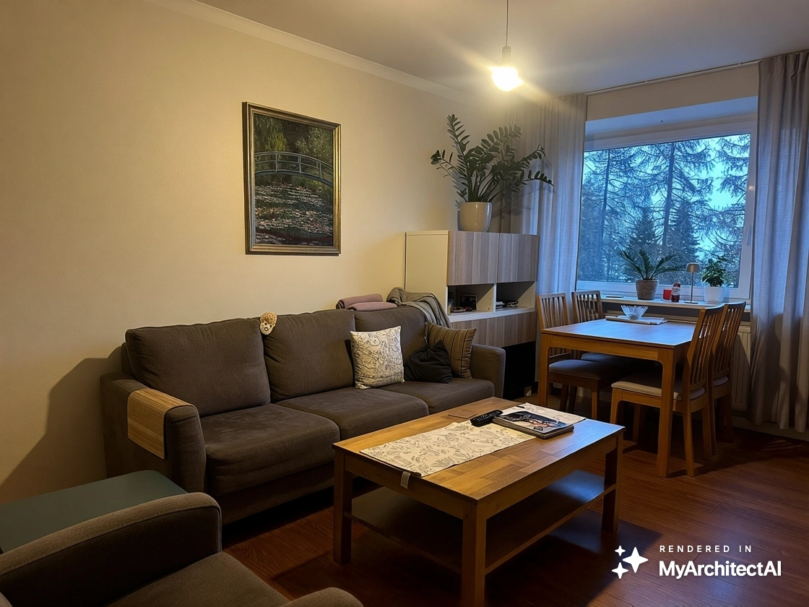
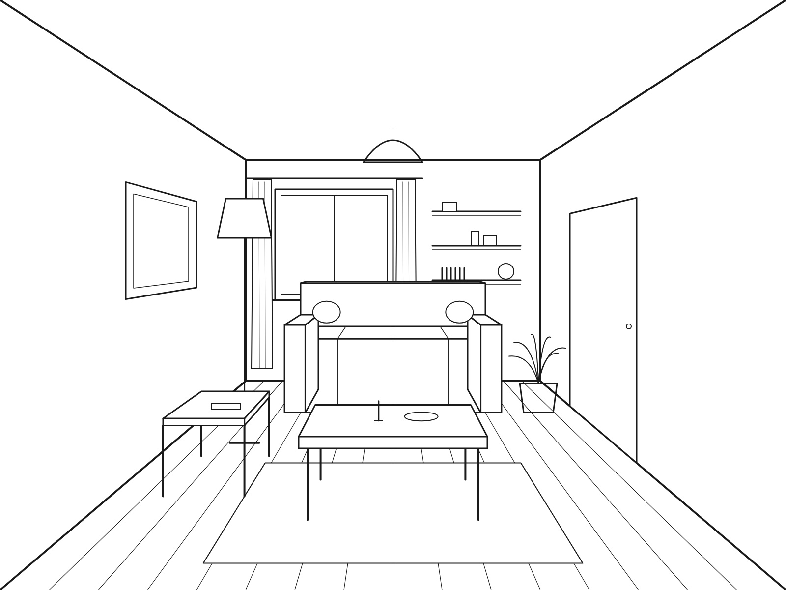
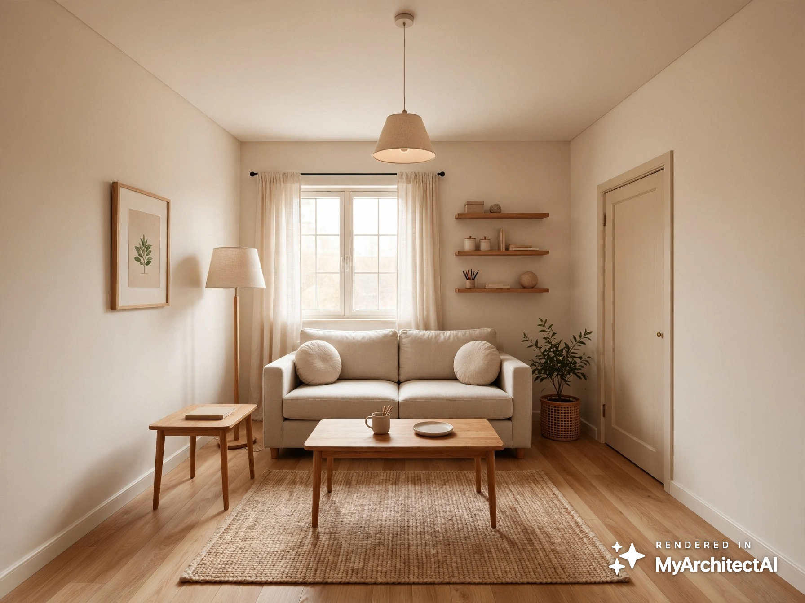
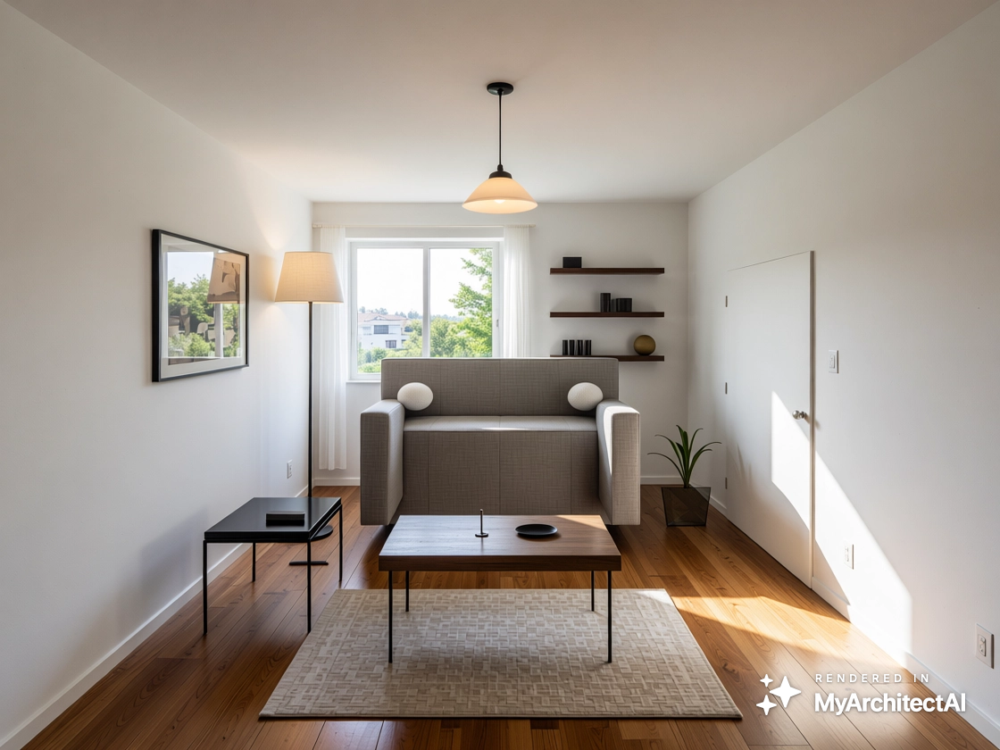
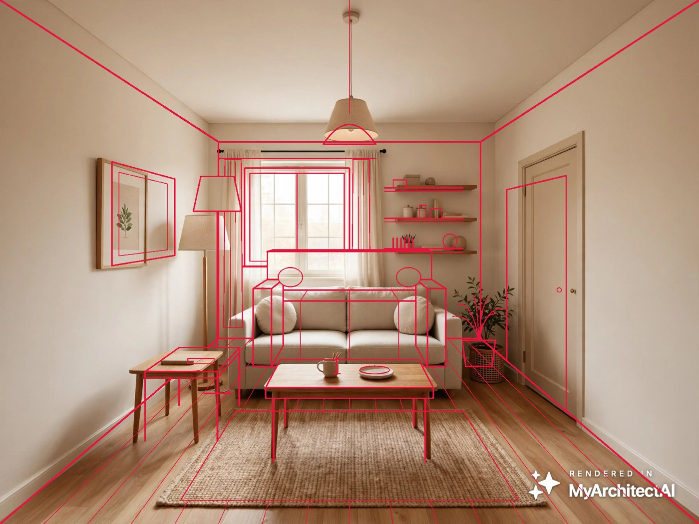
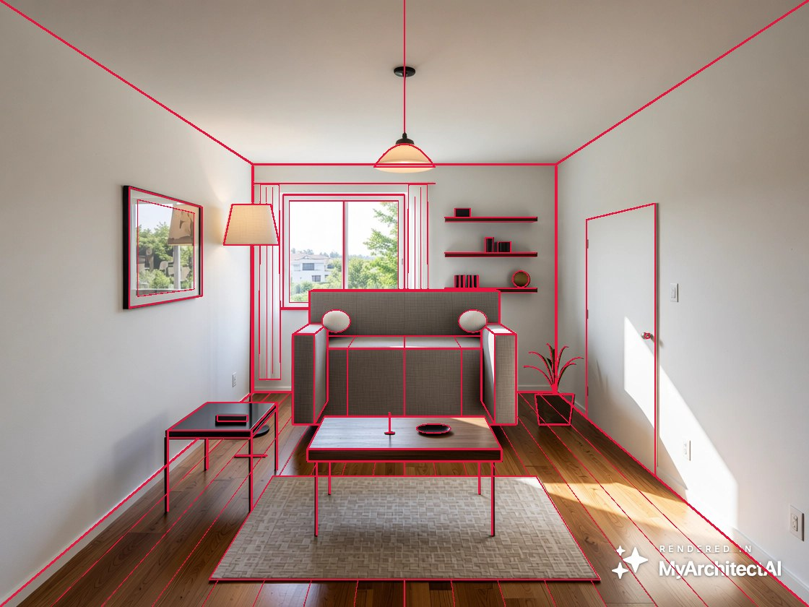
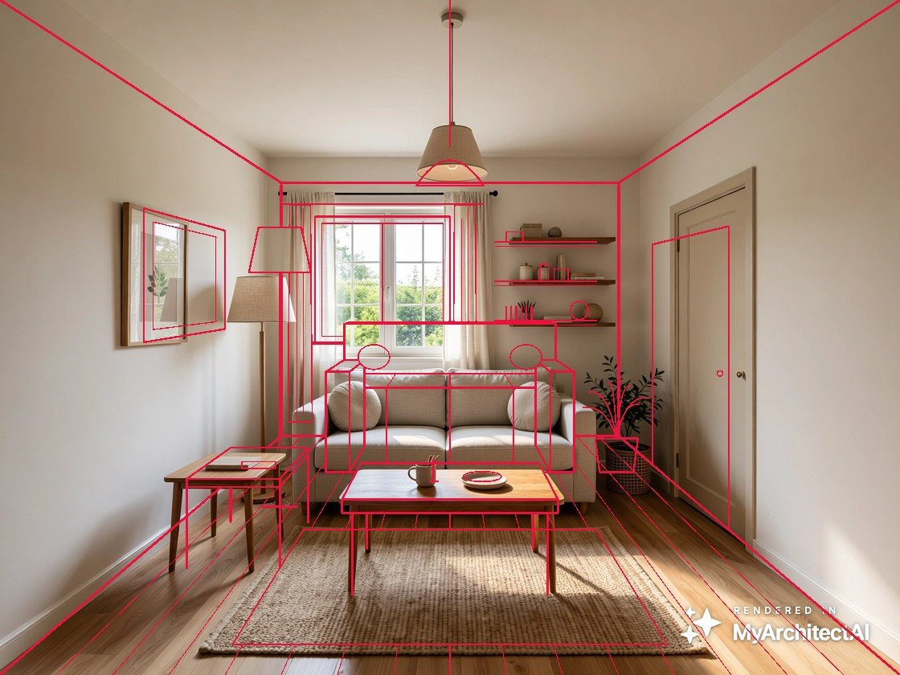

# Day 1 — 9 Nov 2026

**Goal:** I wanted to see what happens when I give an AI interior renderer a photo of my own living room and a simple drawing.

**Tool:** MyArchitectAI (free trial, 6 of 10 renders used)

**Inputs:**
- A: a photo of my living room (iPhone photo, evening light)
- B: a simple line sketch of a living room (made with AI to simulate an architect's drawing)

### Test 1: changing the floor in my living room photo

| Try | Prompt | Mask | Result |
| --- | --- | --- | --- |
| 1 | "Replace the light wooden floor with a dark walnut wooden floor…" (verb first) | Used magic wand to automatically (and quickly) detect the floor area | Uneven colour, patches, old floor still visible in multiple places. The colour came out slightly different than expected, not exactly walnut (maybe wrong lighting) |
| 2 | "Dark chocolate wooden floor (changed the colour as walnut came out lighter than I expected), matte finish" (describing the desired result, from the in-app tip) | Marked the Whole floor manually, including under the furniture and over the chair legs | Even (and darker as I expected before) colour, the chair and table legs survived, the rest of the room unchanged. |

| Original photo | Try 1 (fail) | Try 2 |
| --- | --- | --- |
|  |  |  |

**What I learned:** Funny thing: the help page “Edit by prompt” prompt article AND "Best practices for using the AI render editing toolkit" article both said the prompts should start with a verb, but the app (inside render studio) itself said the prompt should describe the end result, no verbs. The app seemed to be right.

**Honest problem:** I changed three things at once: prompt style, colour description, and how I selected/marked the floor. Possibly all changes were necessary.

### Test 2: playing with a sketch?

| My sketch | With style | No style |
| --- | --- | --- |
|  |  |  |

Red = my original sketch lines laid over the render:

| With style | No style | Style + daylight edit |
| --- | --- | --- |
|  |  |  |

I used Claude to run the measurement (to see the accuracy) and here’s how it works. It shows how many of my sketch lines still have a matching edge in each render :

| Render | Sketch lines kept |
| --- | --- |
| No style | 74% |
| Style + daylight edit | 62% |
| With style | 53% |

A sketch line counts as kept if the render has an edge within about 8 pixels of it, which is less than 1% of the image width.I also tried counting stricter and looser. The numbers changed,
but the order stayed the same every time: no style was always
the most accurate.

**What I saw:**
- With style: looks beautiful and realistic, but the door, floor lamp, side table and picture moved or grew, and the lamp shade changed shape.
- No style: almost everything stays where I drew it, but the sofa looks like a stiff box. That was expected as the sketch was a little strange too (One of the things that would have required manual improving). It copies my drawing very literally (which is actually good).

**The trade-off:** accurate vs pretty.

**Open question:** the daylight edit (made from the styled render) moved things closer to my sketch than the styled render itself. Interesting.

**Next:** set up ComfyUI and try ControlNet.

[← Back to the learning log](LEARNING_LOG.md)
