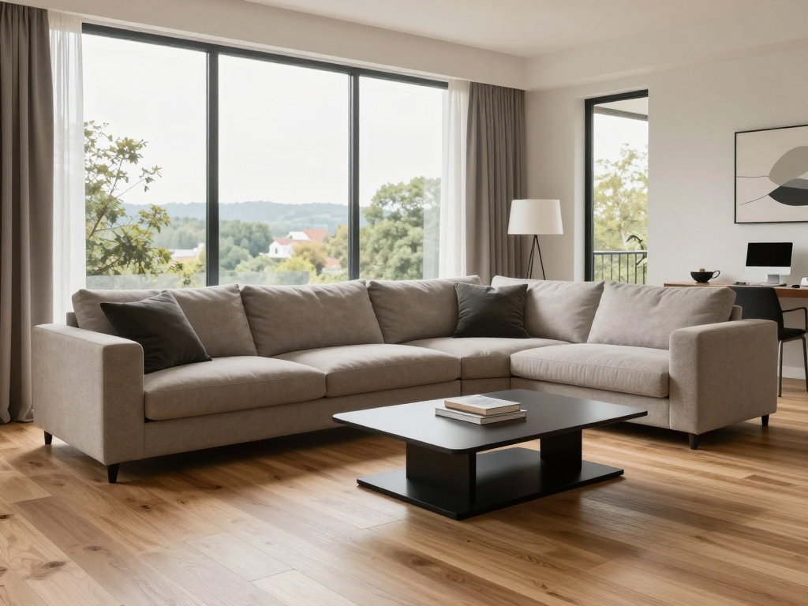
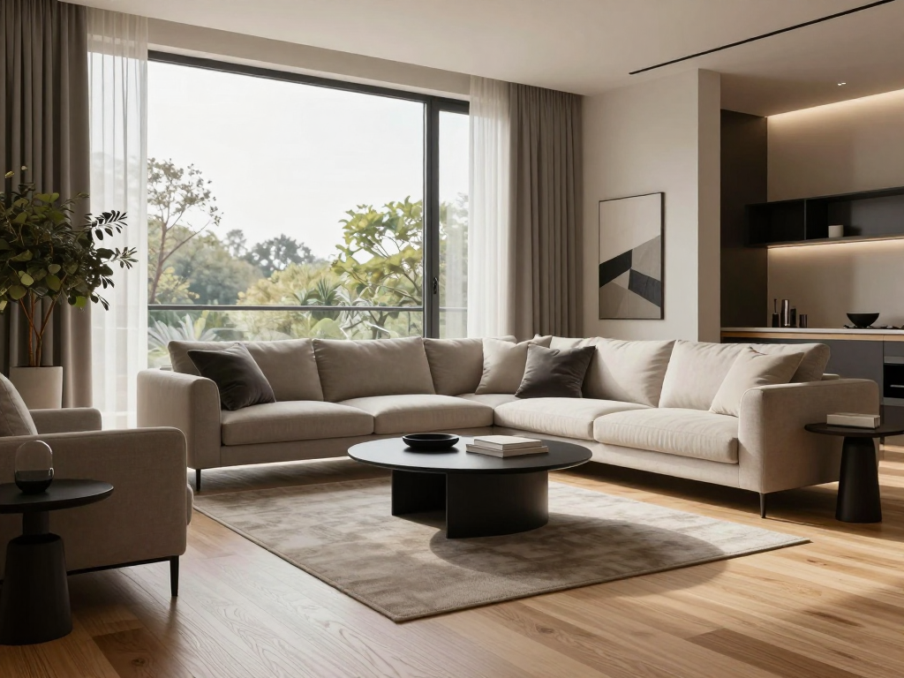
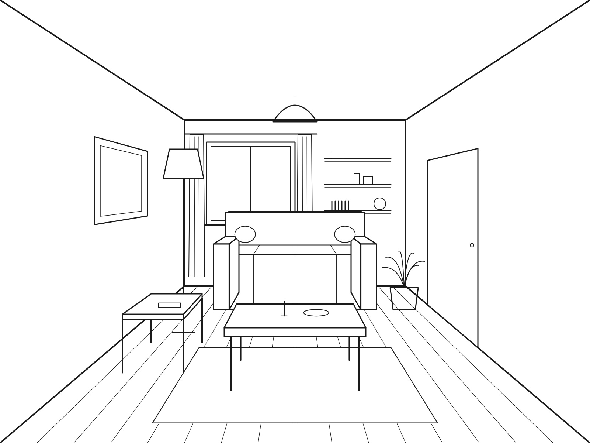
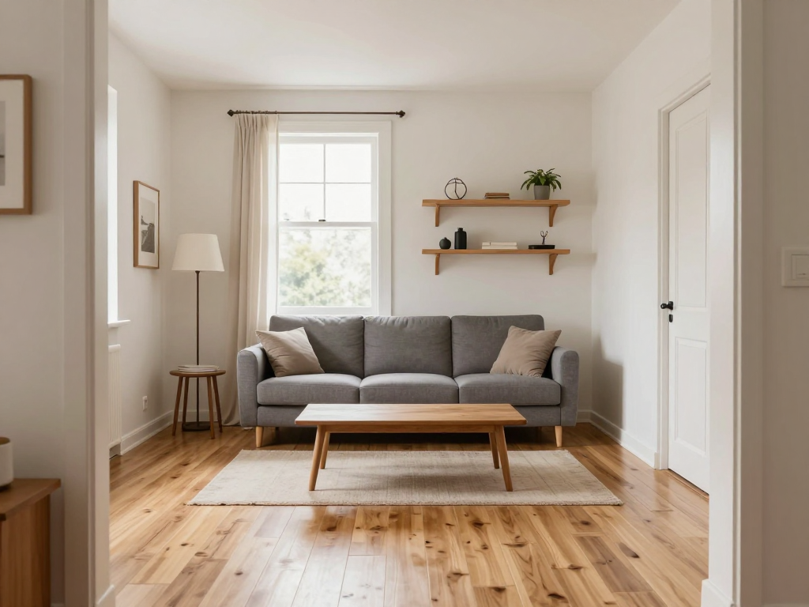
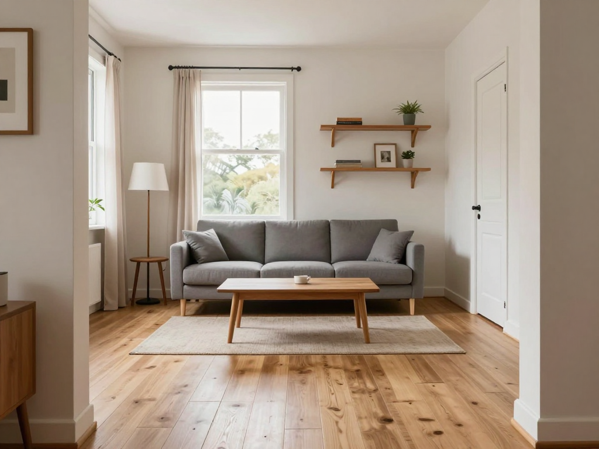

# Experiment 2 — Nov 2026

**Goal:** Learn ComfyUI basics before trying ControlNet. I wanted to understand what actually controls an AI image: the prompt, the seed, or both.

**Tool:** Comfy Cloud (5 free runs), Z-Image Turbo template (text-to-image, 1024 × 768, 8 steps)

### Test 1: does the same seed give the same image?

I ran the same prompt twice with seed 0.

- After my first run, the seed suddenly showed a random long number. I found out the setting next to the seed was on "randomize", so ComfyUI picks a new seed after every run.
- I switched it to "fixed", set the seed back to 0 and ran again.
- **Result:** exactly the same image, pixel for pixel.

**What I learned:** same seed + same settings = same image. This matters because now I can change one thing at a time and know what caused the difference. On Day 1 in MyArchitectAI I couldn't do that.

### Test 2: what does the seed change?

Prompt: "photorealistic modern living room, large window, wooden floor, soft daylight"

| Seed 0 | Seed 1 |
| --- | --- |
|  |  |

**My guess:** small changes, some colours and materials.

**Result:** colours and materials stayed close, but it was a different room: different windows, a round table instead of a square one, a kitchen instead of a desk, extra furniture. Funny detail: both times a beige L-shaped sofa, probably the model's idea of a "modern living room".

**What I learned:** the prompt decides *what* is in the room, the seed decides *how it's arranged*. With a short prompt, the seed changes the whole layout.

### Test 3: can a very detailed prompt describe my sketch?

I described my Day 1 sketch in words (window, three shelves, sofa with round cushions, door on the right etc.) and ran it with seed 0 and seed 1.

| My sketch | Seed 0 | Seed 1 |
| --- | --- | --- |
|  |  |  |

**My guess:** similar to my sketch, but not recognisably the same room.

**Result (seed 0):** about 7 of 10 details right. Wrong: two shelves instead of three, square cushions instead of round, a curtain only on one side. It even drew the doorway frame because I wrote "seen from the doorway". And the furniture is not where I drew it.

**My guess for seed 1:** colours and materials stay but the exact shades change ("grey" can be many greys), the layout changes, one mistake gets fixed, the shelf count stays wrong.

**Result (seed 1):**
- Shades changed: right (the cushions went from beige to grey)
- Shelf count still wrong: right
- Layout changes: wrong, it was almost the same room, the camera just moved back a bit
- One mistake fixed: wrong, the same mistakes came back

**What I learned:**
- The mistakes repeated, so they look like the model's habits, not bad luck. Counting things (three shelves) seems hard for it.
- The more detailed the prompt, the less the seed changes the layout.
- But words alone can't put things where I want them. For an architect that's not enough, the sketch has to go into the model as an image.

**About measuring:** I tried the Day 1 line measurement on these images too, and it gave results that didn't match what I saw. The camera wasn't fixed and the wooden floor texture added a lot of noise. So that measurement only makes sense when the render starts from the sketch and the camera stays the same. I'm only using my eyes for today's tests.

### Checking what I need for next time

Before paying for a plan I checked the Comfy Cloud model library. It has what I need:
- **Juggernaut-XL v9**: a photorealistic SDXL model
- **ControlNet depth** and **ControlNet canny** for SDXL (both from the same maker, so it's a fair comparison)
- **Depth Anything**: makes a depth map from my sketch

**Next:** give the model my sketch as an image and compare depth vs. canny ControlNet. Can it keep my geometry AND look realistic?

[← Back to the front page](README.md)
