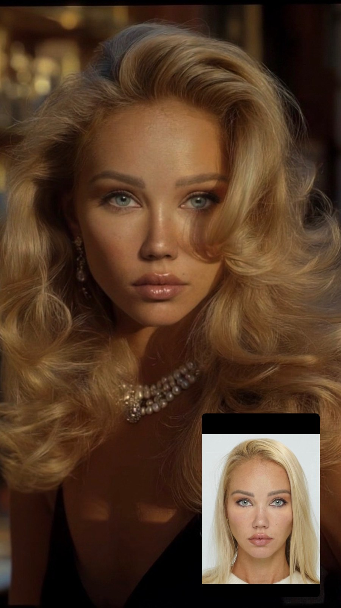
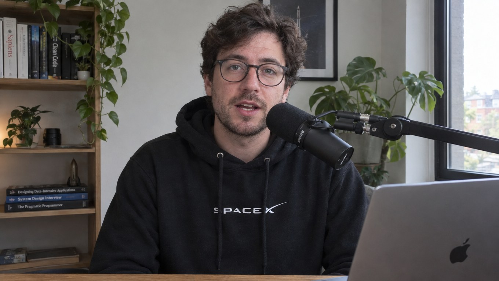
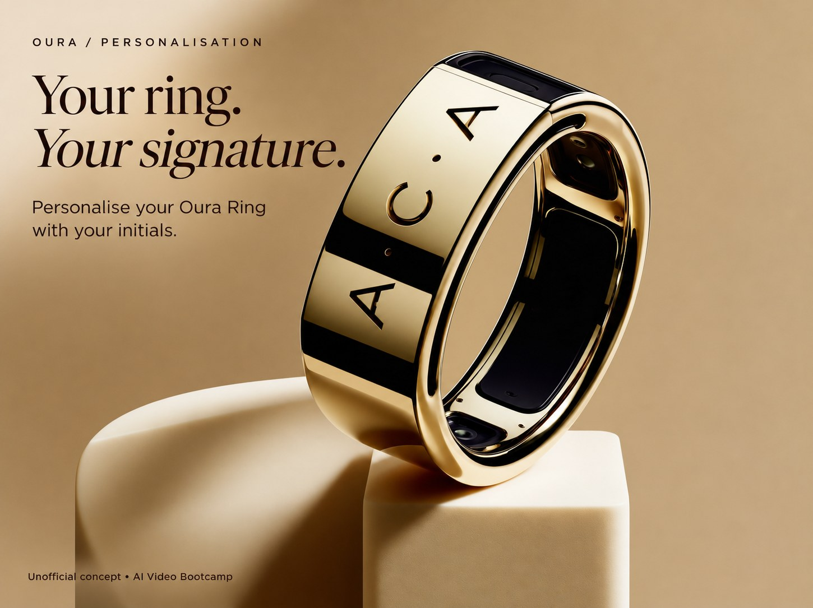

# Experiment 0 — Nov 2026

** My work from AI video Bootcamp ** Three photos, each created with a different purpose. 

**Tools:** Midjourney, Promptwise (to test different models), Higgsfield, Claude and ChatGPT (to help write and improve prompts)

---

### 1. A '90s supermodel character built from my own face

**Goal:** There are many trending short "romantic-comedy 90s style" videos on social media at the moment. I want to start creating my own. One of the basic step is character creation so I have to learn how to master photo creation in that particular style. To challenge it, I wanted on of the characters to have my facial features. The end goal: to be able to use that creation for videos The small photo in the corner is the real me, for comparison.

<!-- TODO Karoliina: roughly how many attempts? --> 10+
<!-- TODO Karoliina: what went wrong at first (e.g. didn't look like me, face changed between images)? --> after testing and improving (with the help of Claude) multiple prompts to get the style right, getting the facial features right was a big challenge because Midjourey has many safety barriers.
<!-- TODO Karoliina: what did you change that helped? --> Took the best result midjpurney gave me to nanobanana, it perfected the face to be recognisable 

**How I judged it:** I compared her side by side with my own photo. And generally to other 90s style rom-com characters.

**Still in progress:** the profile view and the body. To turn that photo into a video character I need many different ankles, full body etc.

---

### 2. Thomas, a tech influencer who doesn't look AI

**Goal:** To try to create a hyperrealistic photo of a tech influencer. As realistic as possible.

**Result:** it took many attempts to stop him looking AI. I'm still not 100% happy, but it's quite close to realism.

<!-- TODO Karoliina: what made him look AI in the early attempts (skin, eyes, lighting, background)? --> In the beginning I used Midjourney but quickly realised it's not the best to create 100% realistic photos of humans. Moved over to Promptwise where I tested different image models, Realism Pro and GPT brought me success 
<!-- TODO Karoliina: what fixed it? --> prompt and model improvement. 
<!-- TODO Karoliina: did you ask for the SpaceX hoodie, or did the AI add it? Add one line about it either way. --> I asked for it, my prompt was quite specific.

---

### 3. A concept ad for the Oura ring

**Goal:** to test product image creation with an invented ad idea: personalising your Oura ring with your initials. The idea was to keep the style of the brand and from technical point of view get the colours, shadows and overall look right and professional.

<!-- TODO Karoliina: what was hard (ring shape, the gold reflections, letters on a curved surface)? --> getting all little details right was a little challenging but generally the easiest test.
<!-- TODO Karoliina: what did you change that helped? --> all base images were created with midjourney, the final design idea in a prompt form is from ChatGPT.

---

**What connects these to this project:** in all three, the hard part was keeping something specific right (my face, a believable person, a product's shape and material) while the AI changes everything else. That's the same problem as keeping a room's geometry while changing its materials.

[← Back to the front page](README.md)
