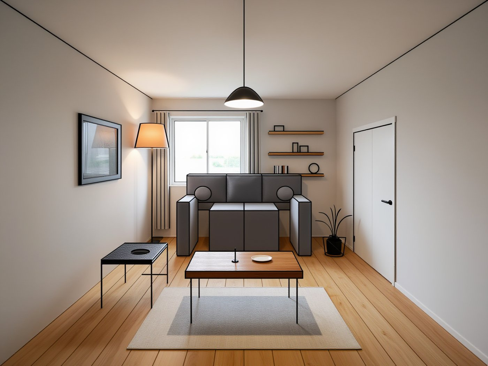
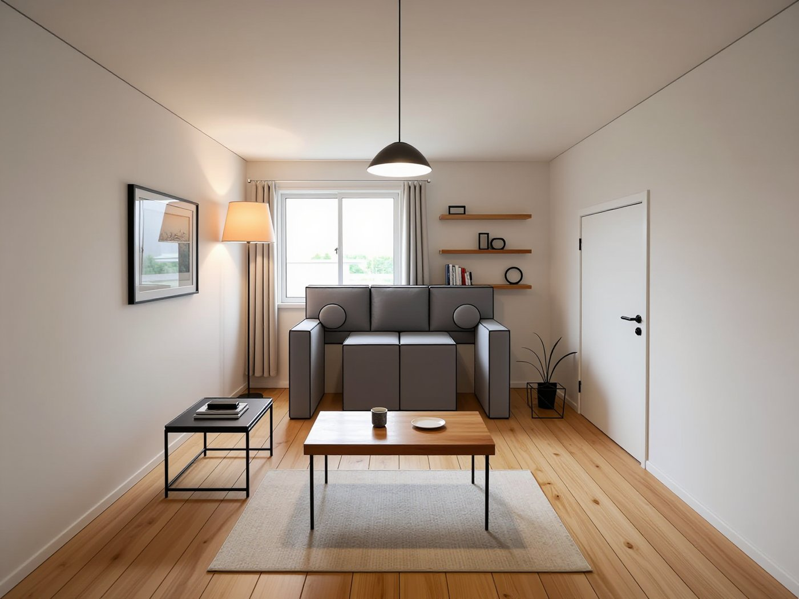
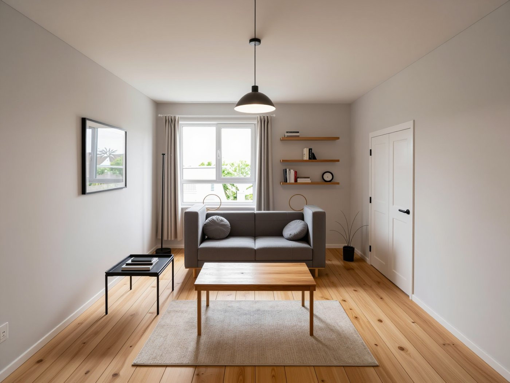
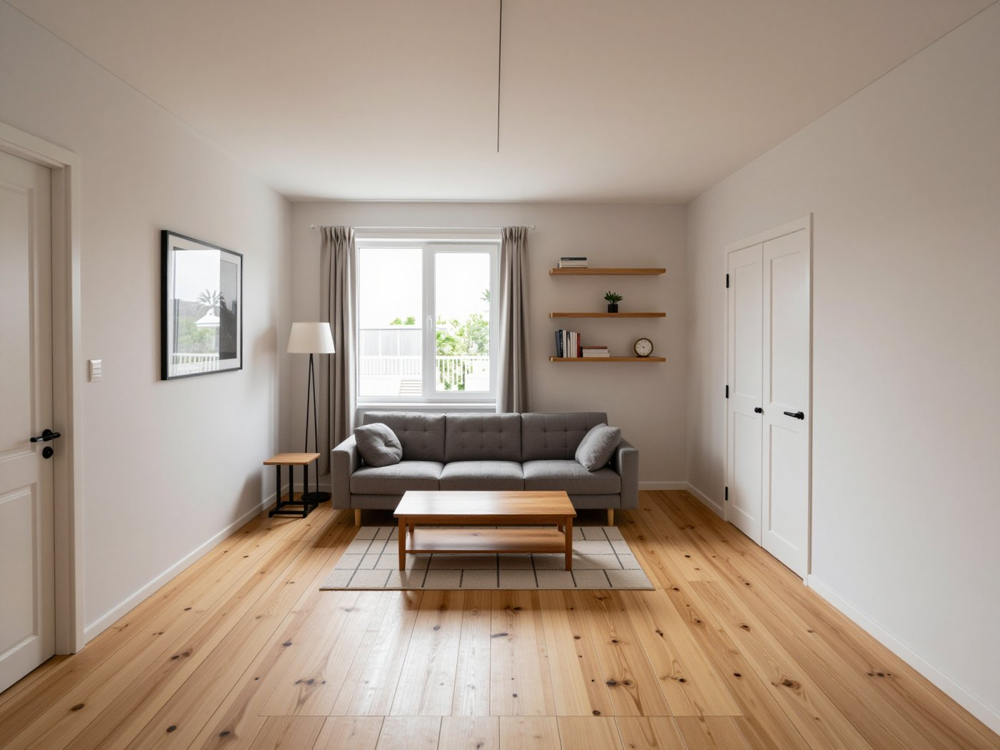
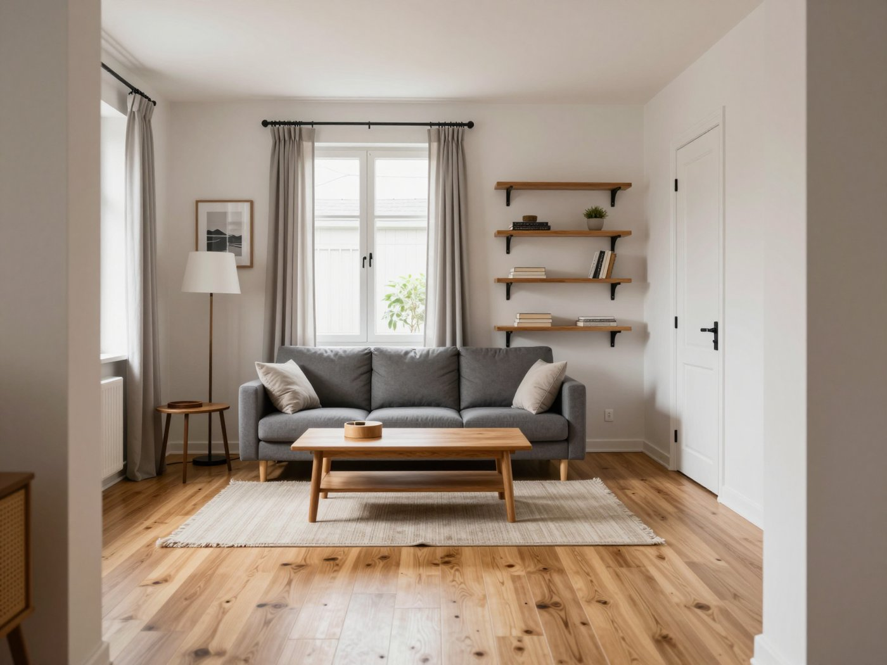
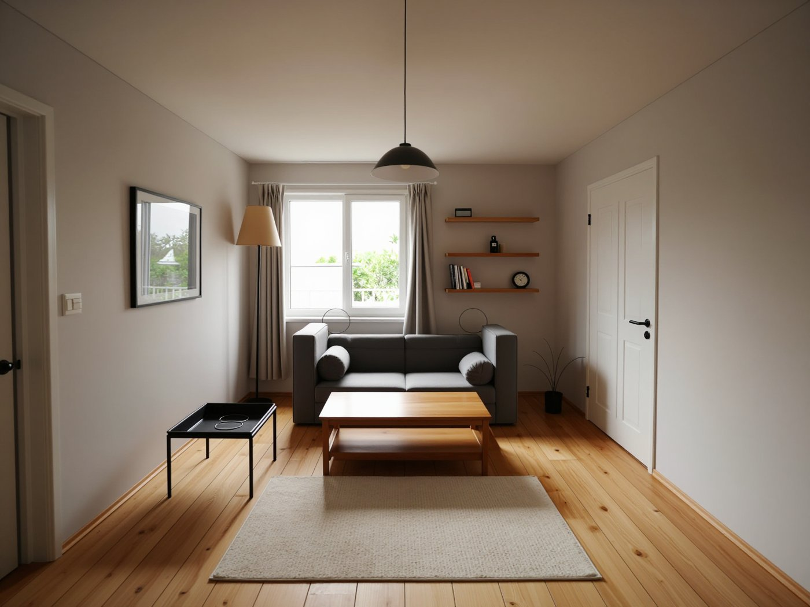
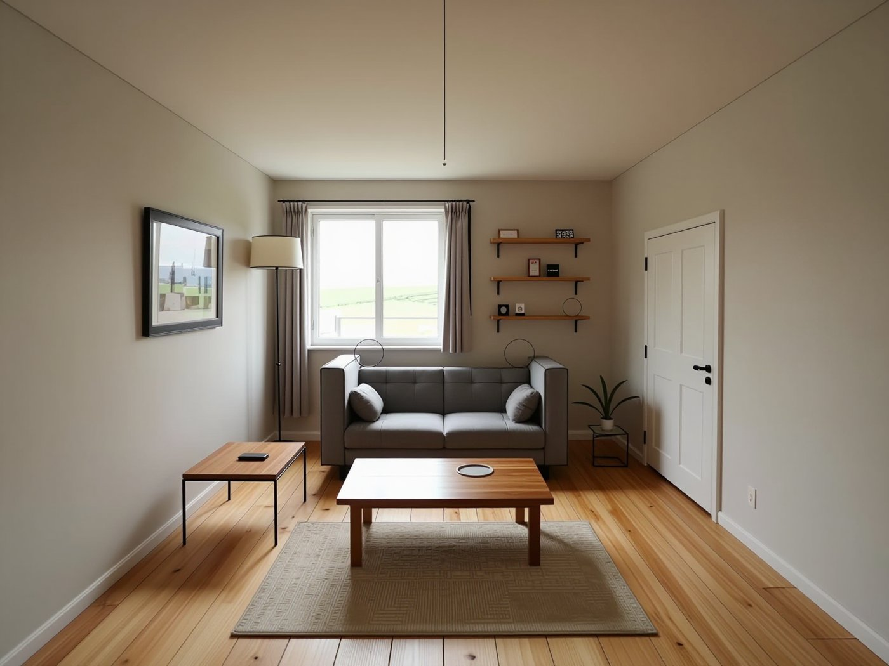
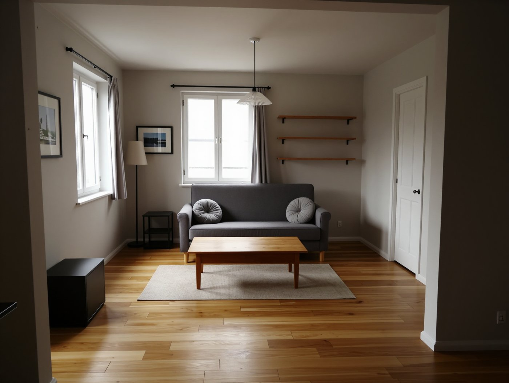

# Experiment 3 — Nov 2026

<!-- Draft written with Claude. Karoliina: rewrite in your own words before applying. -->

**Goal:** give the model my sketch as an image (not only words) with ControlNet. Can it keep my geometry AND look realistic?

**Tool:** Comfy Cloud, template "Z-Image-Turbo Fun Union ControlNet". Same model as Experiment 2, so the only new thing is the guide.

**How I measured geometry:** I used Claude to run the measurement. It lays my sketch lines over the render and counts how many of them still have a matching edge nearby (about 8 pixels). Here it's fair, because the render starts from my sketch, so the camera is fixed. For realism I used my own eye.

---

### Test 1: canny guide at full strength

Canny turns my sketch into a line map, and the model has to follow the lines.

**My guess:** more similar to the sketch, the mistakes from Experiment 2 won't repeat, and the result will look like the MyArchitectAI no-style render (accurate, but a stiff sofa).

**Result:** 95% of my sketch lines kept. Three shelves, round cushions, curtains on both sides: every mistake from Experiment 2 was fixed. But it doesn't look real at all. It even paints my drawn outlines, and the sofa is made of boxes. My guess was right.

**Lesson:** a great score can still be a bad image. Painting the lines themselves gives a perfect geometry score. So from now on I judge every result on two things: geometry (the number) and realism (my eye).

### Test 2: finding the right strength

**My guess:** as the strength goes down, realism gets better and geometry suffers. The art is to find the golden middle point.

Same prompt, same seed (0), only the strength changes:

| Strength | Sketch lines kept | What I see |
| --- | --- | --- |
| 1.00 | 95% | Outlines everywhere, box sofa |
| 0.75 | 90% | Still box sofa, thinner outlines |
| 0.60 | 73% | Room and furniture mostly in place, but still looks artificial. Floor lamp lost its shade, two strange rings float where I drew round cushions |
| 0.55 | 64% | Lamp shade back but too small and too low, sofa pushed back |
| 0.50 | 59% | Looks real, but furniture moved and shrank, pendant lamp and plant disappeared, an extra door appeared |
| 0.25 | (by eye: a different room) | What I'd call realistic, but the camera, windows and shelves changed |

| 0.75 | 0.60 | 0.50 | 0.25 |
| --- | --- | --- | --- |
|  |  |  |  |

Red = my sketch lines on top of the 0.60 render:

**Result:** my guess was right, but the change isn't gradual. Between 0.75 and 0.50 there's a big jump. I locked 0.60 as the best balance.

**Why 0.25 looks real and 0.60 doesn't:** at 0.25 the model chooses almost everything itself: a normal camera view, natural furniture sizes, lived-in details (books, a plant, a radiator), real textures and soft daylight. At 0.60 it has to follow my sketch, which has a very wide, perfectly centred view and an empty room. So part of the realism problem is the input itself.

(The measurement gave 0.25 a score of 59%, but by eye it's clearly a different room. The wooden floor has lots of plank lines that happen to match my drawn floor lines, so the score is too kind there.)

### Test 3: a prompt for realism

Same strength (0.60) and seed, but I added photo words to the end of the prompt: *"Real interior photograph, natural afternoon sunlight through the window casting soft shadows on the floor, shot on a 35mm camera, lived-in and cosy, subtle imperfections, realistic textures on walls and fabrics."*

**My guess:** the image will be much more realistic.

| Seed 0 | Seed 1 |
| --- | --- |
|  |  |

**Result:** much better light, darker corners and warmer shadows, more like a phone photo. But still kind of artificial. The rings stayed. Words can't fix something that comes from the sketch lines.

**Seed check:** the layout held with seed 1, and the rings appeared again, so they're a habit and not bad luck. But the geometry score moved from 64% to 70% just because of the seed. So differences smaller than about 6 points can be random. I can't say the prompt "cost" geometry.

### Test 4: depth guide instead of canny

A depth map shows what's near and far instead of lines. Same strength (0.60), same prompt, same seed.

**My guess:** realism will improve, but geometry will suffer.

| Depth map | Result |
| --- | --- |
|  |  |

**Result:** realism improved impressively, but geometry didn't. 51% of my sketch lines kept (canny with the same settings: 64%). The picture became a window, the plant disappeared, the lamps were wrong, and the floor planks now run sideways.

**Why:** the depth map shows the 3D shapes well (room, sofa, tables, lamp shades), but it's blind to anything flat on a wall (window, door, picture, shelves) and to thin things (the plant, the lamp pole). The floor is flat too, so it doesn't know which way the planks run. The round cushions did come back as real cushions, no rings.

(My first depth run came out small, because the depth tool was set to 512. I re-ran it at full size: 52% vs 51%, so the size wasn't the reason.)

---

### What I learned

- **Canny** sees every line: accurate, but it copies things it shouldn't (outlines, rings).
- **Depth** sees only 3D shapes: realistic, but it loses flat details and thin objects.
- **Strength** mostly decides *where things are*, not *how real it looks*.
- **One number is not enough.** I need the geometry score and my eye together, and I need to check more than one seed before trusting a difference.

**Next I'd try:** using both guides at once, depth for the 3D shapes and canny at a lower strength for windows, doors and floor lines. And a better input: a sketch with a normal camera view, like architects' screenshots from 3D software.

[← Back to the front page](README.md)
