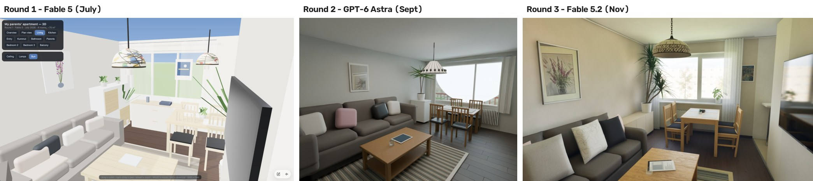
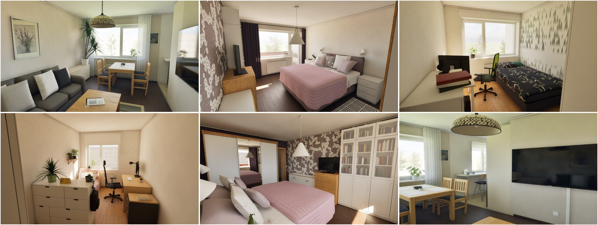

# Experiment 4 — Nov 2026

<!-- Draft written with Claude from Karoliina's notes. Karoliina: check the brother part and rewrite in your own words. -->

**Goal:** how much better do AI models get at turning a real apartment into a 3D model in just a few months? I took one real apartment (my parents' home) and rebuilt it three times, each time with a newer model.

**Input every time:** the floor plan and around 25 photos of the rooms. I left the address and the floor plan out of this page on purpose.

I worked on this with my brother. Round 3 used a toolkit he put together for Claude Code.

---

### Try it yourself

- **[Round 1 in 3D (Fable 5, July)](https://claude.ai/artifact/G5kgYgDm56qwGTLdSSsH7w)**: drag to look around, room buttons on the left
- **[Round 2 in 3D (GPT-6 Astra, September)](https://claude.ai/artifact/DgagVXnPVq53nVFKwBR2Qf)**: walk around with W/A/S/D or the arrow buttons
- Round 3 in 3D: coming soon. It runs in Unreal Engine, so for now there are pictures below.

---

### Same living room, three rounds

| | Round 1 | Round 2 | Round 3 |
|---|---|---|---|
| **When** | July 2026 | September 2026 | November 2026 |
| **Model** | Claude Fable 5 | GPT-6 Astra (Codex) | Claude Fable 5.2 |
| **How** | simple prompt, the model drew everything with code in one web page | prompt written with ChatGPT, built in Blender | my brother's toolkit, Blender + Unreal Engine |
| **What I saw** | right layout, but looks like a video game | massive step towards realism, but I noticed way more random things | another level, the "wow" moment |

**Round 1:** the layout was right: sofa on the left, dining table by the window, TV on the wall. But everything is flat colours and blocky shapes, and part of the wall is missing so you see the sky.

**Round 2:** going from Round 1 to 2 was a massive step towards realism. Real materials and light bouncing off the walls. But I also noticed way more random things, like a strange half circle across the window, and the window is just white.

**Round 3:** another level. Soft light, a real view outside, the wallpapers look like the real ones, the mirrors work and there are small lived-in details like a backpack and plants on a shelf.

---

### What I learned

- **It's not only the model.** Each round I changed three things at once: the model, the tools (code → Blender → Unreal Engine) and the prompt. So I can't say "Fable 5.2 is X times better than Fable 5". I can say the whole setup got much better.
- **More realism brings new mistakes.** Round 1 was simple, so it had few weird things. Round 2 looked much more real, but more random things popped up.
- **The layout was right from the start.** Even Round 1 put the furniture in the right places. The big jumps were in light and materials.

### What I'd still fix

- The view outside the windows is generic. I want to use Google Maps / street view so it shows the real surroundings.
- More lived-in details: clothes, the things my parents actually have around.
- Some wallpapers repeat like a pattern from a game.

### Next I'd try

- Get Round 3 working as a 3D page too, so all three rounds can be explored in the browser.
- A screenshot from the Round 3 model is exactly the kind of input an architect gives a renderer. I want to put it through my Experiment 3 setup and see how much geometry survives.

[← Back to the front page](README.md)
